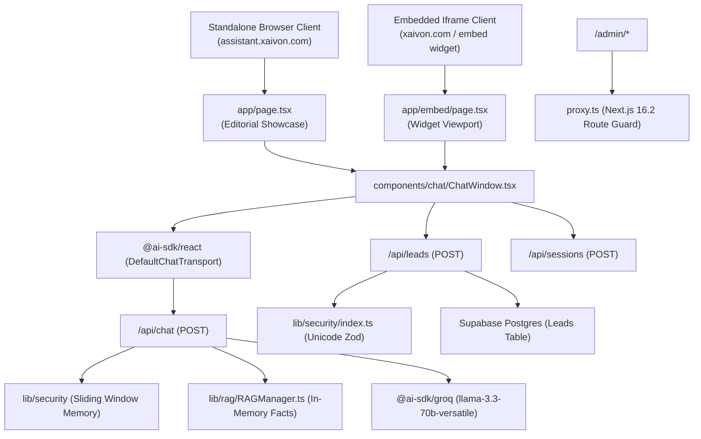

# XAIVON Chatbot — Architecture Inventory & Risk Register

**Repository:** `raja6299/xaivon-chatbot`
**Framework:** Next.js 16.2.10 (App Router, Turbopack), React 19.2.4
**Date:** October 19, 2026

---

## 1. System Architecture Overview

---

## 2. Complete Inventory of Routes, Components & Libraries

### 2.1 Web Routes & Endpoints

| Route / Path | Type | Description | Security Controls |
|---|---|---|---|
| `/` | Server / Client Page | Standalone architectural showcase and direct consultant interface | CSP, HSTS, X-Content-Type-Options |
| `/embed` | Client Page | Lightweight conversational widget for iframe embedding | Strict `frame-ancestors`, dynamic origin `postMessage` |
| `/admin` | Layout / Pages | Internal administrative console | Protected via `proxy.ts` (unauthenticated users redirected to `/admin/login`) |
| `/api/chat` | Route Handler (POST) | Streaming conversational LLM endpoint | Rate-limited (20 req/min), schema validation, no autonomous side-effect tools |
| `/api/leads` | Route Handler (POST) | Visitor consultation lead capture | Rate-limited (5 req/10min), Unicode-safe Zod validation, PII masked in logs |
| `/api/sessions` | Route Handler (POST) | Conversation session initialization | Non-blocking UUID generation with safe Supabase fallback |
| `/api/upload` | Route Handler (POST) | File attachment text extraction (PDF, DOCX, XLSX) | File size caps (10MB), mime-type verification, in-memory parsing |

### 2.2 Core UI Components

| Component | Location | Role & Implementation |
|---|---|---|
| `ChatWindow` | `components/chat/ChatWindow.tsx` | Main conversation container; manages message flow, suggested prompts, streaming status, theme switching, and human escape hatches. |
| `ChatMessage` | `components/chat/ChatMessage.tsx` | Formatted chat bubble with Markdown rendering, copy button, role badge, and Lucide icons. |
| `ChatWidget` | `components/chat/ChatWidget.tsx` | Floating launcher trigger with responsive drawer/popover behaviors. |
| `LeadFormModal` | `components/chat/LeadFormModal.tsx` | Explicit modal for consultative discovery requests; supports international phone numbers and Unicode names. |
| `CalendarModal` | `components/chat/CalendarModal.tsx` | Direct consultation scheduling interface with links to Calendly and direct email contact. |

---

## 3. Comprehensive Risk Register (P0 / P1 / P2)

| ID | Severity | Category | Risk Description | Pre-Fix Baseline Status | Remediation & Current State |
|---|---|---|---|---|---|
| **R-01** | **P0** | **Availability** | Chat stream crashes with generic 500 error on every prompt | **CONFIRMED** (`GROQ_API_KEY` rejected by Groq with 401; unhandled `fetch failed` to dummy Supabase) | **FIXED:** Structured error classification. Outage state returns friendly maintenance notice with founder contact. Zero DB side effects during stream. |
| **R-02** | **P0** | **Integrity** | Production Supabase database writes during ordinary visitor queries | **CONFIRMED** (`RAGManager` attempted upsert to `knowledge_chunks` on every chat call) | **FIXED:** Entire RAG subsystem converted to read-only in-memory keyword matching. Production DB is never written to during chat. |
| **R-03** | **P1** | **Security / SSRF** | Unsafe AI tools (`triggerZapierWebhook`) allowing model to invoke arbitrary URLs | **CONFIRMED** (Exposed in `app/api/chat/route.ts` with naive 3-host blocklist) | **FIXED:** Removed autonomous tools from public chat stream. Implemented RFC1918 + AWS/GCP metadata IP blocking and strict HTTPS validation in `lib/integrations/engine.ts`. |
| **R-04** | **P1** | **Access Control** | Admin dashboard accessible without authentication if env variables missing | **CONFIRMED** (`proxy.ts` passed requests through when Supabase variables were unset) | **FIXED:** `proxy.ts` strictly blocks `/admin` routes if Supabase is unconfigured or user session is unauthenticated. |
| **R-05** | **P1** | **Privacy / Compliance** | PII (raw email, phone) logged to analytics tables | **CONFIRMED** (`lib/security/index.ts` logged raw details) | **FIXED:** Added `maskEmail()` (`r***a@xaivon.com`) and redacted phone numbers in all telemetry and audit logs. |
| **R-06** | **P1** | **Accessibility / UX** | Viewport disabled zoom and pinch-to-zoom on mobile | **CONFIRMED** (`maximumScale: 1, userScalable: false` in `app/layout.tsx`) | **FIXED:** Removed restrictive viewport properties. Compliant with WCAG 2.2 AA. |
| **R-07** | **P1** | **Internationalization** | Devanagari and international Unicode names rejected by lead form | **CONFIRMED** (Regex only matched ASCII letters `[a-zA-Z]`) | **FIXED:** Updated to Unicode regex `/^[\p{L}\p{M}\s\-\.']+$/u` supporting Hindi matras, accents, and international names. |
| **R-08** | **P2** | **Embedding / CSP** | Iframe blocked in non-production preview environments | **CONFIRMED** (Hardcoded `frame-ancestors` in `next.config.ts`) | **FIXED:** Added `ALLOWED_FRAME_ANCESTORS` support in `next.config.ts` and dynamic origin matching in `app/embed/page.tsx`. |
| **R-09** | **P2** | **Truthfulness** | Contradictory hardcoded package prices in system prompt | **CONFIRMED** (System prompt had stale $2,500/mo packages contradicting website) | **FIXED:** Reconciled against `XAIVON_APPROVED_FACTS.ts`. Chatbot clearly indicates pricing is scoped on workflow assessment. |
| **R-10** | **P2** | **UX / Aesthetics** | Generic neon-purple dark theme not aligned with XAIVON architectural brand | **CONFIRMED** (Heavy purple gradients and high-saturation glowing borders) | **FIXED:** Complete redesign using warm ivory & copper (Light) and deep warm charcoal & copper (Dark). |
